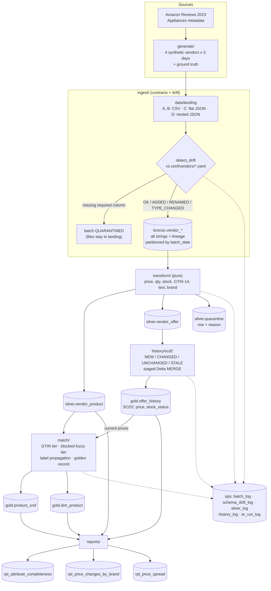

# Multi-vendor product catalogue pipeline

PySpark + Delta Lake, running locally. Four vendors send daily product feeds in different formats.
The pipeline:
1. ingests the feeds and detects schema drift
2. normalizes the data
3. keeps a full price and stock history (SCD2) with incremental loads
4. resolves the same product across vendors (entity resolution)
5. builds reporting tables

It's a one-day learning project: public product names (Amazon Reviews 2023, Appliances) with synthetic
vendors, prices, stock and barcodes.

- New to the problem? Start with **[docs/OVERVIEW.md](docs/OVERVIEW.md)** (no technical background needed).
- Finding your way around the code? Read **[docs/REPO_GUIDE.md](docs/REPO_GUIDE.md)** and
  **[docs/KEY_COMPONENTS.md](docs/KEY_COMPONENTS.md)**.
- The business model? **[docs/DOMAIN.md](docs/DOMAIN.md)** has the bounded contexts, the context map and the glossary.

## Architecture



The `pipeline/` package runs the stages: one orchestration module per stage, and the only place
outside `ingest/` that reads or writes the lake. Everything in `transform/`, `history/`, `match/` and
`reports/` is a pure DataFrame-to-DataFrame function.

## Quickstart

**Prerequisites:**
- Linux or macOS with Python 3.11+ and **Java 17**. The Makefile picks `/usr/lib/jvm/java-17-openjdk-*`;
  override with `make <target> JAVA17_HOME=/path/to/jdk-17`.
- Internet on first run, for PyPI, the Hugging Face source file and the Delta jars from Maven Central.

```bash
make setup     # create .venv, install pyspark 3.5.9 + delta-spark 3.3.3, pyyaml, requests, pytest
make data      # download ~100k Appliances records, generate vendor feeds + ground truth (seeded, deterministic)
make run-all   # batches in date order -> bronze -> silver -> SCD2 history -> entity resolution -> reports
make test      # 124 tests (unit + integration), ~7 min
make bench     # optimization experiments (~15 min), rewrites docs/RESULTS.md
```

Other commands:

| Command | What it does |
|---|---|
| `make run-all` again | Changes nothing: finished batches are skipped, and ER is skipped while its inputs and config are unchanged |
| `.venv/bin/python -m catalog_pipeline.pipeline er --force` | Re-runs entity resolution only |
| `.venv/bin/python -m catalog_pipeline.pipeline reports` | Rebuilds the report tables only |

All tables are Delta tables under `data/lake/{bronze,silver,gold,ops}`. All settings live in
`conf/pipeline.yaml`, and the vendor contracts in `conf/vendors/`.

## Results

Measured on an Intel i5-1335U (12 cores, 38.9 GB RAM), Spark 3.5.9 `local[*]`, 4 GB driver heap, Java 17.
Full tables are in **[docs/RESULTS.md](docs/RESULTS.md)**, generated by `make bench`.

| Metric | Value |
|---|---|
| Landed feed rows (12 vendor batches, 3 days) | 284,208 |
| Vendor records into ER (`silver.vendor_product`) | 217,384 |
| Master products (`gold.dim_product`) | **99,878** (217k records collapse to 100k masters) |
| How records are matched | 104,545 by GTIN · 83,017 fuzzy · 29,822 singletons |
| ER pairwise **precision / recall** | **0.9891 / 0.9133** (target was precision ≥ 0.95) |
| Candidate pairs | ~23.6 billion possible pairs, 403,196 after blocking |
| Blocking: brand-only vs final, pair recall | 0.289 vs 0.855 (0.636 vs 0.924 with GTIN pairs) |
| SCD2 history | 250,282 versions, 217,384 current, 0 invariant violations |

**Throughput (tuned run):**

| Stage | Rows | Seconds | Rows/sec |
|---|---|---|---|
| Batches (bronze + silver + history) | 284,208 feed rows | 216.2 | 1,314 |
| Entity resolution | 217,384 records | 28.3 | 7,683 |
| Reports | 250,282 history rows | 6.8 | 36,950 |

**Tuning: full run from an empty lake:**

| Variant | Shuffle partitions | Broadcast | Total |
|---|---|---|---|
| baseline | 200 | off (SortMergeJoin) | 374.6 s |
| partitions | 8 | off (SortMergeJoin) | 263.1 s |
| tuned | 8 | on (BroadcastHashJoin) | **251.3 s (−33%)** |

- **Partitions:** most of the gain comes from 8 shuffle partitions instead of 200, which means far fewer
  tiny tasks and fewer small files per MERGE. AQE was on in all runs, which already merges small
  partitions at runtime.
- **Broadcast:** broadcasting the small alias table (and letting Spark auto-broadcast small tables)
  added another 5%.
- **Matching results:** identical in all three variants.

## Sample reports

**`rpt_attribute_completeness`** (share of records with a value; `CATALOGUE` = golden records):

| scope | title | brand | category | model | gtin14 |
|---|---|---|---|---|---|
| A | 1.000 | 0.951 | 0.951 | 0.817 | 0.541 |
| B | 1.000 | 0.950 | 0.949 | 0.817 | 0.540 |
| C | 1.000 | 0.951 | 0.949 | **0.000** | 0.538 |
| D | 1.000 | 0.951 | 0.951 | 0.817 | 0.538 |
| CATALOGUE | 1.000 | 0.939 | 0.976 | 0.737 | 0.523 |

Vendor C's contract has no model column at all, which is why its model completeness is 0.

**`rpt_price_changes_by_brand`** (top rows by number of changes):

| brand | change_date | changes | increases | decreases | avg_pct_change |
|---|---|---|---|---|---|
| Whirlpool | 2025-03-02 | 1,259 | 624 | 635 | −0.17 |
| Whirlpool | 2025-03-03 | 1,223 | 627 | 596 | −0.11 |
| GE | 2025-03-03 | 744 | 344 | 400 | −0.57 |
| GE | 2025-03-02 | 668 | 353 | 315 | +0.26 |
| Frigidaire | 2025-03-03 | 619 | 299 | 320 | −0.25 |

**`rpt_price_spread`**: 70,044 masters sold by 2+ vendors. Median spread is 6.6%, mean 7.5%. The top row
(63.8%) is an ER false merge, explained under Limitations.

| master_id | n_vendors | n_offers | min_price | max_price | spread_pct |
|---|---|---|---|---|---|
| A\|A-7464138 | 4 | 5 | 5.66 | 9.27 | 63.8 |
| B\|BX8283731 | 3 | 3 | 434.23 | 657.05 | 51.3 |
| A\|A-8331220 | 3 | 3 | 578.43 | 861.90 | 49.0 |

## How it works (one line per stage)

| Stage | What happens |
|---|---|
| **Drift** | `detect_drift` is a pure function comparing the observed columns with the YAML contract. ADDED is logged and ignored. RENAMED (a declared alias) is mapped. A missing optional column is filled with nulls. TYPE_CHANGED (JSON only) is logged. A missing required column quarantines the whole batch, and the other vendors continue |
| **Bronze** | Contract columns under canonical names, all strings, plus lineage. Written with `replaceWhere` per `batch_date`, so re-running is idempotent |
| **Silver** | One `classify` pass parses prices (`$1,299.00` and `1.299,00`), quantities, stock status, GTIN-14, text and canonical brands, then splits rows into offers, products and quarantine. Rows in = valid + quarantined + deduped, enforced |
| **SCD2** | Rows are classified NEW / CHANGED / UNCHANGED / STALE by `row_hash`. A staged MERGE source lists each changed offer twice (real key closes the old version, NULL key inserts the new one). Intervals are half-open, and current-row reads are pinned with `versionAsOf` |
| **ER** | GTIN exact matches, plus fuzzy matching inside blocks of (brand, model token) and (brand, title prefix). Score = 0.35 token Jaccard + 0.25 Levenshtein ratio + 0.40 price closeness. Model/GTIN vetoes, a price gate, and best match per vendor. Then 3-round label propagation and a golden record per master. Evaluated against ground truth and logged |
| **Reports** | `unpivot` for completeness, `lag()` for price changes, and min/max across xref for spread |

Every behaviour-changing choice is recorded in **[docs/DECISIONS.md](docs/DECISIONS.md)** (D1–D43), with its
alternative and where to change it.

## Domain language

The code uses these terms consistently, so a domain expert can read the table names.

| Term | Meaning | Where |
|---|---|---|
| **Vendor feed / batch** | One vendor's files for one day (`batch_id` = date) | `data/landing/<vendor>/<date>/` |
| **Contract** | What a vendor's feed must look like: columns, aliases, required flags | `conf/vendors/*.yaml` |
| **Drift** | A difference between a feed and its contract | `ops.schema_drift_log` |
| **Quarantine** | A rejected batch (whole) or row (with reason) | `ops.batch_log`, `silver.quarantine` |
| **Vendor product** | A vendor's listing, keyed by (vendor_id, vendor_sku) = `record_key` / `offer_key` | `silver.vendor_product` |
| **Offer** | A vendor product's price and stock on a given day | `silver.vendor_offer` |
| **Offer version** | A period during which an offer's price and stock status didn't change | `gold.offer_history` |
| **Master product** | One real-world product across vendors (`master_id`) | `gold.dim_product` |
| **Golden record** | The attributes chosen to represent a master | `gold.dim_product` |
| **Crosswalk / xref** | Which master each vendor product belongs to, and how it was matched | `gold.product_xref` |

The full context map, with what each context owns, publishes and guarantees, is in
[docs/DOMAIN.md](docs/DOMAIN.md). The packages follow the same areas:
- intake: `ingest/`, `transform/`
- price history: `history/`
- catalogue matching: `match/`
- reporting: `reports/`

## Limitations

- **Currency:** USD only, with no FX.
- **Batch order and delisting:**
  - Products that disappear from a feed are never closed or marked delisted.
  - Out-of-order and late batches are rejected.
  - A quarantined day can't be replayed once a later day has succeeded for that vendor.
- **Master IDs are rebuilt each run:** a master's ID is its smallest record_key, so IDs can shift as
  records arrive. Production would persist the crosswalk and match new records against existing
  masters first (D26).
- **Chaining through model-less records (D25):** a record with no model number isn't vetoed and can
  bridge two products. The real example is the top price-spread row above:
  - two different water filter products share a near-identical title: one listed with model
    `SGF-G9 (1 pack)`, the other with no model at all
  - the model-less record links to both sides, so they end up as one master with a 63.8% "spread"
- **The ground truth is optimistic:**
  - We wrote the noise ourselves, so the metrics measure how well the pipeline detects our own noise types.
  - The matching weights were tuned on the same ground truth they are evaluated on (D23).
  - The brand reference table is built from the clean catalogue.
- **Laptop numbers:** local mode only, one run per bench variant (a few % noise), and no claims about
  how it scales on a cluster.
- **Stock history:** only the status (IN / LOW / OUT) is tracked, not the raw quantity.
- **Ambiguous prices:** bare forms like `1.299` or `1,299` can't be told apart.
- **Not measured:** Delta OPTIMIZE/ZORDER and snapshotPartitions tuning (D9, D15).
- **Out of scope:** streaming, orchestration, Docker/cloud, ML matching, dashboards.

## Project layout

```
conf/                 pipeline.yaml (every setting) + vendors/*.yaml (contracts)
src/catalog_pipeline/
  generate/           synthetic vendor feeds + ground truth (stdlib only, seeded)
  ingest/             contracts, drift detection, bronze writes, ops logs
  transform/          pure column/DataFrame cleaning functions
  history/            pure SCD2 logic
  match/              pure entity resolution (candidates, score, cluster, golden, evaluate)
  reports/            pure report builders
  pipeline/           per-stage orchestration (all lake I/O outside ingest/) + CLI
  bench.py            make bench
tests/unit, tests/integration
docs/                 OVERVIEW, DOMAIN, REPO_GUIDE, KEY_COMPONENTS, DECISIONS, RESULTS, MILESTONES, HANDOFF, GIT
```
