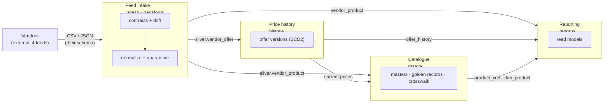

# Domain model

This file covers the strategic half of domain-driven design (DDD):
- the language the code speaks
- the bounded contexts it's split into
- how those contexts depend on each other

The tactical half (entity, aggregate and repository classes) is left out on purpose. The pipeline
works on whole datasets at once, and wrapping rows in Python objects would need `.collect()` or UDFs.
Instead, the business rules live in pure DataFrame functions, apart from the I/O, which is the DDD
idea that matters.

## Context map

**How the contexts relate:**

- **Vendors to Feed intake: an anti-corruption layer.**
  - Vendors are external, and each speaks its own dialect (column names, formats, price styles).
  - Intake translates every feed into one canonical model: the contract, drift detection, canonical
    column names, parsing and quarantine.
  - So no other context ever sees a vendor's raw schema. If vendor B renames `title` to `name`, only
    `conf/vendors/b.yaml` knows.
- **Between contexts: a published language.** Each context publishes Delta tables with explicit schemas,
  and downstream contexts read only those tables, never another context's internals. Delta gives
  atomic commits and versioned reads, so a consumer sees one published state at a time. Catalogue, for
  example, reads its inputs pinned to a table version.
- **Upstream and downstream: customer/supplier.** Intake supplies History and Catalogue, and History
  supplies current prices to Catalogue. The run order follows these arrows (batches, then ER, then
  reports).
- **Reporting is a conformist.** It owns no business rules about products or prices, and takes the
  other contexts' models as they are. Brand in the price report is "the golden brand of the offer's
  current master" (D34).
- **Shared kernel:** the identity of a vendor product, `vendor_id | vendor_sku`. Intake keys products by
  (vendor_id, vendor_sku), History calls it `offer_key` and Catalogue calls it `record_key`. Same value,
  named for each context (see the glossary).
- **Cross-cutting, not a context:** the `ops` logs (run bookkeeping for every context) and `pipeline/`
  (orchestration and I/O). Neither holds domain rules.

## The four bounded contexts

### 1. Feed intake: `ingest/`, `transform/`, orchestrated by `pipeline/silver.py`
**Responsibility:** accept or reject what vendors send, and turn the accepted data into clean, typed,
canonical vendor products and offers.

| | |
|---|---|
| **Owns** | `bronze.vendor_*`, `silver.vendor_product`, `silver.vendor_offer`, `silver.quarantine`, `ops.batch_log`, `ops.schema_drift_log`, `ops.silver_log` |
| **Publishes** | `silver.vendor_product` (latest values per vendor product) and `silver.vendor_offer` (price and stock per offer per day) |
| **Rules (invariants)** | <ul><li>A batch missing a required column with no alias is quarantined whole, and other vendors carry on.</li><li>Rows in = valid + quarantined + deduped, or the batch fails.</li><li>Bad rows are kept with a reason, never dropped.</li><li>An older batch never overwrites newer product values.</li><li>A vendor's batch older than its last success is rejected.</li></ul> |
| **Language** | vendor feed, batch, contract, alias, drift (ADDED, MISSING, RENAMED, TYPE_CHANGED), quarantine, canonical brand, GTIN-14, stock status |
| **Decisions** | D2-D8 (D1 and D9 are project-wide) |

### 2. Price history: `history/`, orchestrated by `pipeline/history.py`
**Responsibility:** remember every price and stock-status change of every offer, without ever
overwriting the past.

| | |
|---|---|
| **Owns** | `gold.offer_history`, `ops.history_log` |
| **Publishes** | `gold.offer_history` (and its current rows = today's prices) |
| **Rules (invariants)** | <ul><li>Exactly one current version per offer.</li><li>Versions are back to back with half-open intervals: no gaps, no overlaps.</li><li>Only price and stock_status make a new version.</li><li>A day already applied is STALE and ignored.</li><li>One batch = one atomic MERGE.</li></ul> These are checked by `scd2.invariant_violations`. |
| **Language** | offer, offer version, valid_from / valid_to, current, NEW / CHANGED / UNCHANGED / STALE, row hash |
| **Decisions** | D10-D18 |

### 3. Catalogue: `match/`, orchestrated by `pipeline/er.py`
**Responsibility:** decide which vendor products are the same real-world product, and what that
product's best description is.

| | |
|---|---|
| **Owns** | `gold.product_xref`, `gold.dim_product`, `ops.er_run_log` |
| **Publishes** | `gold.product_xref` (vendor product to master, and how it was matched) and `gold.dim_product` (one golden record per master) |
| **Rules (invariants)** | <ul><li>Two records from the same vendor are never matched directly.</li><li>Different model numbers or GTINs never match.</li><li>Prices too far apart never match (fuzzy tier).</li><li>A fuzzy edge must be each side's best match within the other vendor.</li><li>Every vendor product belongs to exactly one master.</li><li>The golden record is the most complete member, ties broken by vendor priority.</li><li>Precision is preferred over recall (target ≥ 0.95).</li></ul> |
| **Language** | record, master product, golden record, crosswalk (xref), block, candidate pair, edge, match method (GTIN / FUZZY / SINGLETON) |
| **Decisions** | D19-D31 |

### 4. Reporting: `reports/`, orchestrated by `pipeline/reports.py`
**Responsibility:** answer business questions from the other contexts' published tables.

| | |
|---|---|
| **Owns** | `gold.rpt_attribute_completeness`, `gold.rpt_price_changes_by_brand`, `gold.rpt_price_spread` |
| **Publishes** | the three report tables (rebuilt in full every run) |
| **Rules** | <ul><li>A price change is two consecutive versions with different prices.</li><li>Spread only covers masters sold by 2+ vendors, at current prices.</li><li>A missing brand is reported as UNKNOWN.</li></ul> |
| **Language** | completeness, scope (vendor or CATALOGUE), price change, spread |
| **Decisions** | D32-D37 |

## Glossary (ubiquitous language)

| Term | Context | Meaning | In code / data |
|---|---|---|---|
| Vendor | all | A company that sends us a product feed (A, B, C, D) | `vendor_id` |
| Vendor feed / batch | Intake | One vendor's files for one day | `batch_id` (YYYY-MM-DD), `data/landing/<vendor>/<date>/` |
| Contract | Intake | What a vendor's feed must contain: columns, canonical names, types, required flags, aliases | `conf/vendors/*.yaml`, `ingest/contracts.py` |
| Alias | Intake | Another known name for a contract column | `aliases:` in a contract |
| Drift | Intake | A difference between a feed and its contract: ADDED, MISSING, RENAMED, TYPE_CHANGED | `ingest/drift.py`, `ops.schema_drift_log` |
| Quarantine | Intake | A rejected batch (whole, not ingested) or row (kept with a reason) | `ops.batch_log` QUARANTINED, `silver.quarantine` |
| Canonical brand | Intake | The agreed spelling of a brand ("Whirlpool Corp" becomes "Whirlpool") | `transform/brand.py` |
| GTIN-14 | Intake, Catalogue | A barcode normalized to 14 digits | `gtin14` |
| Stock status | Intake, History | IN / LOW / OUT, derived from quantity | `stock_status` |
| Vendor product | Intake | A vendor's listing, identified by (vendor_id, vendor_sku) | `silver.vendor_product` |
| Offer | Intake, History | A vendor product's price and stock on a day. Its identity is `offer_key` = `vendor_id\|vendor_sku` | `silver.vendor_offer` |
| Offer version | History | One period during which an offer's price and stock status didn't change | a row of `gold.offer_history` |
| Current version | History | The open version (`valid_to` NULL, `is_current` true) | `is_current` |
| Record | Catalogue | A vendor product as ER sees it: the same identity, named `record_key` | `match/candidates.prepare` |
| Block / candidate pair | Catalogue | Records sharing a cheap key, and the pairs worth scoring | `match/candidates.py` |
| Edge | Catalogue | An accepted match between two records (GTIN or FUZZY) | `match/score.combine_edges` |
| Master product | Catalogue | One real-world product across vendors | `master_id`, `gold.dim_product` |
| Golden record | Catalogue | The attributes chosen to represent a master | `gold.dim_product`, `golden_record_key` |
| Crosswalk (xref) | Catalogue | Which master each record belongs to, and how it was matched | `gold.product_xref` |
| Completeness | Reporting | The share of records that have a value for an attribute | `rpt_attribute_completeness` |
| Price spread | Reporting | (max − min) / min of a master's current prices across vendors | `rpt_price_spread` |

## Where the boundaries show up in the code

- **Package per context.** The intake rules live in `ingest/` and `transform/`, history in `history/`,
  catalogue in `match/` and reporting in `reports/`. These packages hold pure functions only.
- **One orchestrator per context** in `pipeline/`: `silver.py`, `history.py`, `er.py` and `reports.py`.
  Each one reads its inputs, calls the pure functions, writes the tables it owns and logs its run.
- **No reaching across.** A context's functions take the published DataFrames as arguments.
  `match/` never imports from `history/`; it receives `current_prices` as a DataFrame.
  `reports/` imports nothing from `match/` beyond reading published columns.
- **Config is split the same way:** `conf/pipeline.yaml` has `silver`, `history`, `er` and `reports`
  sections, one per context.

## Possible next steps (not done)

- Rename packages to the context names (`ingest` to `intake`, `match` to `catalogue`). This is cosmetic:
  every import and doc would change, with no change in behaviour.
- Give each context its own table-schema module (as `history/scd2.HISTORY_SCHEMA` already does), so
  every published table has its schema declared in code next to its owner.
